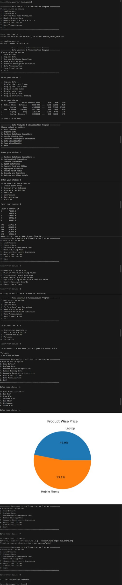
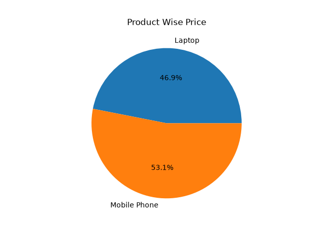

# 📊 Pandas Analyzer & Data Visualization

### 🚀 A Python-Based Sales Data Analysis and Visualization System

<p align="center">
  <b>Explore • Analyze • Clean • Transform • Visualize</b>
</p>

---

## 🌟 About The Project

Welcome to **Pandas Analyzer & Data Visualization**, a Python-based data analysis project developed to perform various operations on real-world sales data.

This project provides a menu-driven application that allows users to load, explore, clean, manipulate, analyze, and visualize sales datasets using powerful Python libraries.

It combines the capabilities of **Pandas, NumPy, and Matplotlib** to simplify data analysis and transform raw data into meaningful information.

The application works with a mobile sales dataset and provides multiple options for performing DataFrame operations, mathematical calculations, statistical analysis, and graphical visualizations.

The main purpose of this project is to gain practical experience in Python programming, data manipulation, data cleaning, statistical calculations, and data visualization.

---

## 🎯 Project Objectives

The main objectives of developing this project are:

- To understand the practical implementation of Python libraries.
- To learn how to load and process CSV datasets.
- To perform data exploration and data cleaning.
- To understand Pandas Series and DataFrames.
- To perform mathematical operations using NumPy.
- To apply different DataFrame manipulation techniques.
- To calculate statistical measurements.
- To understand data grouping and aggregation.
- To generate meaningful graphical representations.
- To develop a structured, menu-driven Python application.
- To improve logical thinking and problem-solving skills.

---

## 💡 Why This Project?

In real-world applications, raw data is often unorganized and may contain missing values, duplicate records, and unnecessary information.

Analyzing such data manually can be difficult and time-consuming.

This project provides a simple solution by allowing users to perform multiple operations through an interactive menu.

It helps transform raw sales records into organized information that can be used to understand product prices, regional sales, product distribution, and other sales-related patterns.

---

## 🖥️ Project Preview



---

## 📂 Project Structure

```text
project_9/
│
├── mobile_sales_data.csv
│
├── pandas_analyzer_&_data_visualization.py
│
├── pandas_analyzer_&_data_visualization.png
│
├── pie_chart.png
│
└── README.md
```

### 📁 File Description

| File Name | Description |
|---|---|
| `mobile_sales_data.csv` | Contains mobile sales records used for analysis. |
| `pandas_analyzer_&_data_visualization.py` | Main Python application containing all program logic. |
| `pandas_analyzer_&_data_visualization.png` | Screenshot of the project interface. |
| `pie_chart.png` | Sample pie chart generated by the application. |
| `README.md` | Project documentation. |

---

## 🛠️ Technologies & Libraries Used

### 1. Python
Python is the core programming language used to develop the complete application.

### 2. Pandas
Pandas is used for data manipulation and analysis.

**Operations performed:**
- Reading CSV files.
- Creating and manipulating DataFrames.
- Exploring dataset information.
- Handling missing values.
- Removing duplicate records.
- Sorting and filtering records.
- Grouping and aggregating data.
- Creating Pivot Tables.
- Combining and splitting DataFrames.
- Statistical analysis.

### 3. NumPy
NumPy is used for numerical calculations and array operations.

**Operations performed:**
- Array creation.
- Array indexing.
- Array slicing.
- Addition.
- Subtraction.
- Multiplication.
- Division.

### 4. Matplotlib
Matplotlib is used to create different graphical visualizations.

**Visualizations:**
- Bar Plot.
- Line Plot.
- Scatter Plot.
- Pie Chart.
- Histogram.
- Stack Plot.

### 5. Seaborn
Seaborn is imported as an additional statistical visualization library and can be used for future visualization enhancements.

---

## ✨ Key Features & Functionalities

### 1. 📥 Load Dataset

Load sales data from a CSV file using Pandas.

Features:
- Read CSV files using `pd.read_csv()`.
- Load the dataset into a DataFrame.
- Convert date columns into datetime format.
- Handle FileNotFoundError.
- Handle unexpected loading errors.

### 2. 🔍 Explore Dataset

Explore the loaded dataset using different options.

| Operation | Pandas Method |
|---|---|
| First 5 Records | `head()` |
| Last 5 Records | `tail()` |
| Column Names | `columns` |
| Data Types | `dtypes` |
| Dataset Information | `info()` |
| Statistical Summary | `describe()` |

### 3. 🧹 Handle Missing Data

Data cleaning is an important part of data analysis.

This module provides:

- Display rows containing missing values.
- Fill missing numerical values with mean.
- Drop rows containing missing values.
- Replace missing values with a specific value.
- Remove duplicate records.
- Convert data types.

**Important Pandas Methods:**

`isnull()`, `any()`, `fillna()`, `dropna()`, `drop_duplicates()`, `to_datetime()`.

### 4. 🧮 Mathematical Operations & NumPy Arrays

Perform numerical operations on the Price column.

Features:
- Create a NumPy array.
- Display the first and third elements.
- Display the first five elements.
- Perform addition.
- Perform subtraction.
- Perform multiplication.
- Perform division.

### 5. 🔗 Combine DataFrames

Combine two different datasets using three methods.

**Concatenation – `pd.concat()`**

Combines multiple DataFrames into one DataFrame.

**Merge – `pd.merge()`**

Combines datasets using a common column such as Product Code.

**Join – `DataFrame.join()`**

Joins two DataFrames using their index.

### 6. ✂️ Split DataFrames

Divide the dataset into smaller groups.

Available options:
- Split by Region.
- Split by Product.

The program extracts records belonging to each unique category and displays them separately.

### 7. 🔎 Search, Sort & Filter

Perform data retrieval and organization operations.

- Search records using Product Name.
- Sort records using selected column names.
- Filter records based on specific values.
- Display matching records.

**Pandas Methods:**

`sort_values()`, conditional filtering, and column selection.

### 8. 📈 Aggregate Functions

Calculate important numerical values from selected columns.

| Function | Description |
|---|---|
| Sum | Calculates the total value. |
| Mean | Calculates the average value. |
| Count | Counts non-missing values. |
| Minimum | Finds the smallest value. |
| Maximum | Finds the largest value. |

### 9. 📊 Statistical Analysis

Perform statistical calculations to understand numerical data.

Available operations:

- Descriptive Statistics.
- Standard Deviation.
- Variance.
- Percentile.

**Pandas Methods:**

`describe()`, `std()`, `var()`, `quantile()`.

### 10. 📋 Create Pivot Table

Generate a Pivot Table to summarize sales information.

Features:
- Use Region as the index.
- Use Product as columns.
- Calculate total Price.
- Summarize product-wise regional data.

**Method:** `pd.pivot_table()`.

### 11. 🗂️ GroupBy & Transform

Group records according to selected categories.

Available operations:
- Group sales by Region.
- Group sales by Product.
- Calculate total Price for each group.
- Calculate average Price for each Product using Transform.

**Pandas Methods:**

`groupby()`, `sum()`, `transform()`, `mean()`.

### 12. 🔄 Reindex & Alter Labels

Manage DataFrame structure and column labels.

- Reindex DataFrame columns.
- Change the order of selected columns.
- Rename existing column names.
- Display updated column labels.

**Pandas Methods:**

`reindex()`, `rename()`.

### 13. 🎨 Data Visualization

Generate different graphical representations of sales data.

| Chart Type | Purpose |
|---|---|
| Bar Plot | Compare product-wise total prices. |
| Line Plot | Display price trends over dispatch dates. |
| Scatter Plot | Show relationships between two selected columns. |
| Pie Chart | Represent product-wise price distribution. |
| Histogram | Display price distribution and frequency. |
| Stack Plot | Compare product prices across dispatch dates. |

### 14. 💾 Save Visualization

Save generated charts for future reference.

Features:
- Generate a visualization.
- Enter a custom image filename.
- Save charts as image files.
- Store generated plots in the project directory.

**Matplotlib Method:** `savefig()`.

---

## 🏗️ Program Architecture

The project is developed using Object-Oriented Programming concepts.

The complete application is organized into a class named `SalesDataAnalyzer`.

### Main Class: `SalesDataAnalyzer`

This class contains different methods responsible for individual operations.

| Method Name | Responsibility |
|---|---|
| `__init__()` | Initializes the application. |
| `__del__()` | Displays the closing message. |
| `load_data()` | Loads the CSV dataset. |
| `explore_data()` | Explores dataset information. |
| `clean_data()` | Handles missing and duplicate data. |
| `mathematical_operations()` | Performs NumPy and mathematical operations. |
| `combine_data()` | Combines multiple DataFrames. |
| `split_data()` | Splits data by categories. |
| `search_sort_filter()` | Searches, sorts, and filters records. |
| `aggregate_functions()` | Performs aggregation calculations. |
| `statistical_analysis()` | Calculates statistical measurements. |
| `create_pivot_table()` | Creates a Pivot Table. |
| `groupby_transform()` | Performs grouping and transformation. |
| `reindex_data()` | Reindexes and renames columns. |
| `visualize_data()` | Generates graphical visualizations. |
| `save_visualization()` | Saves generated charts. |

### Main Function

The `main()` function controls the complete application.

It:
- Creates an object of the `SalesDataAnalyzer` class.
- Displays the main menu.
- Accepts user input.
- Calls the appropriate class methods.
- Continues execution using a `while` loop.
- Exits the application when the user selects option 8.

---

## 🧠 Python Concepts Used

This project demonstrates practical implementation of several Python concepts.

| Concept | Implementation |
|---|---|
| Classes & Objects | `SalesDataAnalyzer` class and its object. |
| Constructor | `__init__()` method. |
| Destructor | `__del__()` method. |
| Instance Variables | `self.data`, `self.current_plot`. |
| Instance Methods | Different data analysis methods. |
| Conditional Statements | `if`, `elif`, `else`. |
| Loops | `while` and `for` loops. |
| User Input | `input()` function. |
| Exception Handling | `try`, `except`. |
| Functions | `main()` function. |
| File Handling | Loading CSV datasets and saving charts. |
| Libraries & Modules | Pandas, NumPy, Matplotlib, Seaborn. |

---

## 🔄 Data Analysis Workflow

The project follows a systematic workflow to process and analyze the dataset.

```text
          START
            |
            ▼
      Initialize Program
            |
            ▼
        Load Dataset
            |
            ▼
       Explore Dataset
            |
            ▼
       Clean the Data
            |
            ▼
    Perform DataFrame Operations
            |
            ▼
      Statistical Analysis
            |
            ▼
      Data Visualization
            |
            ▼
      Save Visualization
            |
            ▼
       Exit Program
            |
            ▼
           END
```

---

## 📊 Dataset Information

**Dataset Name:** `mobile_sales_data.csv`

The project uses a mobile sales dataset containing information about products, brands, prices, quantities, regions, and dates.

### Important Dataset Columns

| Column Name | Description |
|---|---|
| Product Code | Unique product identification code. |
| Product | Name of the mobile product. |
| Brand | Brand of the mobile product. |
| Price | Price of the product. |
| Quantity Sold | Number of units sold. |
| Region | Sales region. |
| Inward Date | Date when the product was received. |
| Dispatch Date | Date when the product was dispatched. |

### Dataset Usage

The dataset is used for:

- Product-wise price analysis.
- Region-wise sales analysis.
- Product comparison.
- Date-based price trends.
- Statistical calculations.
- Data grouping and summarization.
- Graphical representation of sales information.

---

## 🛡️ Error Handling & Data Validation

The project includes basic error handling to make the application more reliable.

Some implemented error-handling techniques include:

- `FileNotFoundError` when the CSV file is unavailable.
- General exception handling using `except Exception as e`.
- Checking whether the dataset is loaded before performing operations.
- Checking whether entered column names exist in the DataFrame.
- Displaying messages for invalid menu selections.
- Handling invalid date values using `errors='coerce'`.

These techniques help prevent common runtime errors and provide meaningful feedback to users.

---

## ⚙️ Installation & Setup

Follow the steps below to run this project on your computer.

### Step 1: Install Python

Download Python from:

https://www.python.org/downloads/

### Step 2: Install Required Libraries

Open the terminal and execute:

```bash
pip install pandas numpy matplotlib seaborn
```

### Step 3: Clone Repository

```bash
git clone https://github.com/Vishakha-Junjiya/project_9.git
```

### Step 4: Navigate to Project Directory

```bash
cd project_9
```

### Step 5: Run the Program

```bash
python pandas_analyzer_&_data_visualization.py
```

**Note:** Ensure that the CSV dataset is available in the project directory or provide its correct path when prompted.

---

## ▶️ How to Use the Project

After executing the Python file, the program displays a menu-driven interface.

### Main Menu

```text
Sales Data Analyzer Initialized!

========== Data Analysis & Visualization Program ==========

Please select an option:

1. Load Dataset
2. Explore Data
3. Perform DataFrame Operations
4. Handle Missing Data
5. Generate Descriptive Statistics
6. Data Visualization
7. Save Visualization
8. Exit

==========================================================
```

### Step-by-Step Execution

1. Select Option 1 to load the mobile sales dataset.
2. Select Option 2 to explore the dataset.
3. Select Option 3 to perform DataFrame operations.
4. Select Option 4 to clean the dataset.
5. Select Option 5 to perform statistical analysis.
6. Select Option 6 to generate visualizations.
7. Select Option 7 to save generated charts.
8. Select Option 8 to close the application.

---

## 📸 Sample Visualization

### 1. Pie Chart

The pie chart represents the product-wise distribution of total prices.



### 2. Bar Plot

The bar plot helps compare total prices among different products.

### 3. Line Plot

The line plot represents price trends over dispatch dates.

### 4. Scatter Plot

The scatter plot helps visualize the relationship between two numerical columns.

### 5. Histogram

The histogram represents the frequency distribution of product prices.

### 6. Stack Plot

The stack plot provides a visual comparison of product prices across dispatch dates.

---

## 🌍 Real-World Applications

The concepts implemented in this project can be applied to various real-world scenarios.

**1. Retail Business Analysis**

Analyze product prices, quantities, and sales categories.

**2. Sales Performance Monitoring**

Understand product-wise and region-wise sales performance.

**3. Inventory Management**

Organize product information and examine inward and dispatch dates.

**4. Business Reporting**

Generate summaries, statistical reports, and visual charts.

**5. Data Analytics**

Understand raw datasets and convert them into meaningful information.

---

## ⭐ Advantages of the Project

- Simple and easy-to-use menu-driven interface.
- Multiple data analysis operations in one application.
- Supports CSV dataset processing.
- Uses powerful Python libraries.
- Provides different data cleaning techniques.
- Supports numerical and statistical calculations.
- Generates multiple visualization types.
- Allows users to save graphical outputs.
- Demonstrates practical Object-Oriented Programming concepts.

---

## ⚠️ Project Limitations

Some current limitations of the application are:

- The application currently supports CSV input.
- Dataset column names are predefined for several operations.
- Some operations depend on the availability of specific columns.
- Visualizations are generated using predefined chart configurations.
- The application currently uses a command-line interface.
- Advanced interactive dashboards are not included.

---

## 🚀 Future Enhancements

The project can be enhanced with additional functionalities in the future.

- Add support for Excel datasets.
- Develop an interactive graphical user interface.
- Create advanced sales dashboards.
- Add more statistical analysis methods.
- Include additional visualization techniques.
- Export processed datasets into CSV and Excel formats.
- Add automated sales report generation.
- Implement advanced filtering and searching.
- Introduce Machine Learning models for sales prediction.
- Add interactive visualizations using Plotly.

---

## 🎓 Learning Outcomes

Through this project, I gained practical knowledge and experience in:

- Python Object-Oriented Programming.
- Working with external Python libraries.
- Reading and processing CSV files.
- Pandas Series and DataFrames.
- NumPy arrays and mathematical operations.
- Data cleaning and preprocessing.
- DataFrame manipulation.
- Sorting, filtering, merging, and joining.
- GroupBy and Transform operations.
- Pivot Table creation.
- Statistical analysis.
- Data visualization using Matplotlib.
- Exception handling.
- Building menu-driven applications.
- Organizing and documenting Python projects.

---

## 👩‍💻 Developer Information

**Name:** Vishakha Junjiya

**Project:** Pandas Analyzer & Data Visualization

**Technology:** Python

**Domain:** Data Analysis & Data Visualization

**GitHub Profile:** [Vishakha-Junjiya](https://github.com/Vishakha-Junjiya)

This project is developed as part of my Python learning journey to strengthen my understanding of data analysis, data manipulation, and visualization techniques.

---

## ❤️ Acknowledgement

I would like to thank my faculty and mentors for their guidance and support throughout the development of this project.

This project helped me understand how Python libraries can be used together to solve practical data analysis problems.

---

## ⭐ Support & Feedback

If you find this project useful or interesting:

- Give this repository a ⭐ Star.
- Explore the source code.
- Share your feedback.
- Suggest new features and improvements.

Your support and suggestions are always appreciated!

---

<h3 align="center">✨ Keep Learning | Keep Exploring | Keep Growing ✨</h3>

<p align="center">
  <b>Thank You for Visiting My Project! ❤️</b>
</p>